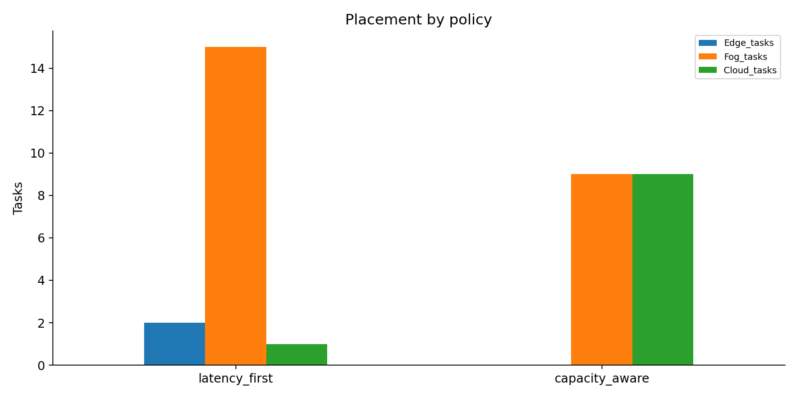

# Compute Playground

**Subject: CDEF Computing**  
*A little computer world where jobs find a place to work.*

Welcome! Imagine three pretend workshops. You give them jobs. Our Python program decides which workshop has enough room and can finish quickly enough. Then it keeps track of what is busy and what is free.

**The computers are imaginary. The decisions and changing records are real Python logic.** This project does not start a real server VM or reserve your laptop's CPU/RAM.

[Open the interactive book](README.html) for search, expandable chapters, copy buttons, a working allocation toy, questions with answers, and a progress checklist. Download/extract the whole project first, then double-click `README.html`. It works offline, needs no Python, and explains the project; it does not control the simulator. This Markdown book works in a text editor or repository viewer too.

## Choose your adventure

| I want to… | Go here |
|---|---|
| Understand the idea without code | [1. The story](#1-the-story) |
| Learn the words | [2. Our tiny dictionary](#2-our-tiny-dictionary) |
| Run the application | [3. Open the playground](#3-open-the-playground) |
| Try it with my own hands | [4. Your first job](#4-your-first-job) |
| See every folder and file | [5. The map of the house](#5-the-map-of-the-house) |
| Follow a job through the code | [6. Follow one job](#6-follow-one-job) |
| Understand the choosing rules | [7. How the chooser thinks](#7-how-the-chooser-thinks) |
| Understand time, VMs and ownership | [8. Time and ownership](#8-time-and-ownership) |
| Repeat the experiments | [9. Be a scientist](#9-be-a-scientist) |
| Read the numbers and pictures | [10. Read the scoreboard](#10-read-the-scoreboard) |
| Fix a problem | [11. When something goes wrong](#11-when-something-goes-wrong) |
| Prepare the presentation and viva | [12. Show and tell](#12-show-and-tell) |

## 1. The story

Imagine you have a drawing to finish. You can take it to one of three workshops:

| Workshop | Computer name | Helpers: CPU units | Table space: RAM | Travel delay | Helper speed |
|---|---|---:|---:|---:|---:|
| Next door | Edge | 4 | 4 GB | 5 ms | 1 |
| Around town | Fog | 12 | 16 GB | 25 ms | 2 |
| Far away | Cloud | 32 | 64 GB | 100 ms | 4 |

A nearby workshop is quick to reach. A faraway workshop has more helpers and faster work. Nearby does not always mean the whole job finishes fastest!

These numbers are **our chosen pretend-world settings**, not measurements of real computers. See the [node settings](config/nodes.json). The application actually starts from `DEFAULT_NODES` in [engine.py](simulator/engine.py); the JSON is an exported reference copy, not a live settings file.

When a job takes 2 helpers from Edge, 2 helpers remain free. Another job needing 3 cannot fit there right now. When the first job finishes or stops, its helpers become free again. Nothing gets randomly printed to make that happen: the engine changes and checks its saved state.

<details><summary>Try a tiny question: Edge has 4 CPU units. A job takes 2. What remains?</summary>

**2 CPU units.** If that VM stops, the 2 units return. Stopping it again gives back nothing extra.

</details>

[Back to the adventure menu](#choose-your-adventure)

## 2. Our tiny dictionary

| Word | Small-child explanation | Exact meaning here |
|---|---|---|
| Task | A job card | ID, owner, CPU, RAM, sensitivity, work and arrival time |
| Node | A workshop | One simulated Edge, Fog or Cloud computer |
| CPU | Helpers doing work | Abstract processing capacity reserved by a task |
| RAM | Space on a table | Reserved memory capacity, measured in GB |
| Latency | Waiting for the trip | Fixed network delay included in response time |
| Work | How big the job is | CPU-ms of work at speed 1 |
| VM | A booking ticket | A Python record reserving CPU/RAM on a node |
| Policy | A choosing rule | Algorithm selecting an eligible node |
| Tenant | The name on your toy box | Demo owner `tenant_a` or `tenant_b` |
| Utilization | How much is busy | Used capacity divided by total capacity |
| QoS | Did we meet our promise? | Predicted response within the sensitivity budget |
| CSV | A sheet of rows and columns | Results file you can open in a spreadsheet |
| Deterministic | Same game, same ending | Identical inputs and starting state give identical outputs |

## 3. Open the playground

You need **Python 3.10 or newer** and an internet connection for installing packages the first time. After installation, the simulator runs locally.

1. Extract the submission ZIP. Open the `Compute_Playground` folder inside it.
2. Open a terminal **inside that folder**. You should be able to see `app.py` and `requirements.txt`.
3. On Windows, run each line in order:

```powershell
python -m venv .venv
.venv\Scripts\python.exe -m pip install -r requirements.txt
.venv\Scripts\python.exe -m streamlit run app.py
```

What did those lines do?

- `venv` makes a little private toolbox called `.venv`.
- `pip install` fills the toolbox with the packages listed in [requirements.txt](requirements.txt).
- `streamlit run` opens the application built by [app.py](app.py).

Open the local address printed by Streamlit, usually `http://localhost:8501`. Keep that terminal open. Press **Ctrl+C** in it to stop the application. On a later visit, only the last command is needed.

<details><summary>macOS / Linux commands</summary>

```bash
python3 -m venv .venv
.venv/bin/python -m pip install -r requirements.txt
.venv/bin/python -m streamlit run app.py
```

Use `.venv/bin/python` in place of `.venv\Scripts\python.exe` in the Windows commands elsewhere in this book.

</details>

No paid cloud, Docker, database, hypervisor, API key or real VM is needed. The application lives in one Python process. Closing/restarting its session can lose live simulation state; exported CSV files stay on disk.

## 4. Your first job

Start with a fresh simulation using **Reset with these settings**. Keep the first policy, `latency_first`, selected and use `tenant_a`.

1. Open **Submit task**.
2. Enter ID `my-first-job`, CPU **2**, RAM **1**, sensitivity **high**, work **80**.
3. Press **Place task**.
4. Edge should be selected. It uses **2 of 4 CPU** and **1 of 4 GB**.
5. Its work time is `80 / (2 × 1) = 40 ms`. Its predicted response is `40 + 5 = 45 ms`.
6. Look at **Tasks and VMs**. Find your job and its booking ticket, `vm-my-first-job`.
7. Press **Advance 50 ms**. The task becomes `completed` and its resources return.

To try stopping instead: reset, submit the same job again, select its running VM under **Tasks and VMs**, and press **Stop selected VM** before advancing time. Its task becomes `cancelled` and the VM becomes `stopped`.

<details><summary>Why do I see only nine tasks after loading eighteen?</summary>

The sample contains nine tasks belonging to each of two tenants. The task and VM tables show only the current tenant's records. Node resource bars show shared totals. The sample loader also advances to 100 ms, so some jobs have already finished by the time loading ends.

</details>

## 5. The map of the house

Each folder is a room. Each file has a job. The links below open the real files.

```text
Compute_Playground/
  README.md                    This book in Markdown
  README.html                  The interactive offline edition
  app.py                       Buttons, forms, tables and resource bars
  requirements.txt             Packages needed to run the simulator
  requirements-docs.txt        Extra package for rebuilding the PDF
  build_report.py              Makes the report and architecture picture
  simulator/
    __init__.py                Marks this as a Python package
    engine.py                  Tasks, policies, clock, VMs, ownership, accounting
  config/
    nodes.json                 Exported node-settings reference
  workloads/
    baseline.json              Exported 18-task reference
    overload.json              Exported 20-task reference
  experiments/
    run_experiments.py         Creates workloads, runs scenarios, saves evidence
  tests/
    test_engine.py             Nine simulation correctness tests
    test_ui.py                 Two interface behaviour tests
  results/
    summary.csv                One row per performance scenario
    <scenario>_tasks.csv        Decisions and predicted response for every task
    <scenario>_vms.csv          VM allocation and status records
    <scenario>_utilization.csv  Resource snapshots at simulation events
    charts/
      placements.png           Where jobs went
      qos.png                  Predicted mean and p95 response
      utilization.png          Peak CPU/RAM use
  evidence/
    experiments.json           Setup, expectation, outcome and evidence pointers
    security.json              Denied view/stop attempts
    lifecycle.json             Resource release after stopping twice
    test_output.txt            Recorded automated test output
    screenshots/               Pictures of the working interface
  docs/
    report.pdf                 Seven-page formal report
    presentation.pptx          Six-slide presentation
    architecture.png           System diagram
    demo_script.md             A five-minute demonstration route
    viva.md                    Questions and talking points
    team_details.md            Your actual team information goes here
```

### The front room: what you see

[app.py](app.py) draws the Streamlit interface. The sidebar chooses a demo identity, policy and Edge settings. Tabs show tasks/VMs, custom submission, saved experiments and protected-record access. It keeps an `Engine` in Streamlit session state, so ordinary button clicks work on the same simulation.

### The engine room: what makes it work

[simulator/engine.py](simulator/engine.py) owns the rules and state. `Task` is a job card; `Engine` is the organiser. This file handles capacity checks, policy scores, resource reservations, VM creation/stopping, completion events and tenant ownership checks. It works without Streamlit too.

### The scientist's room

[experiments/run_experiments.py](experiments/run_experiments.py) defines `workload()` and the overload workload, starts fresh engines, runs comparisons, writes CSV/JSON, and draws charts using matplotlib. **Edit that Python file to change generated experimental workloads.** The JSON workload files are exported reference copies; the runner does not read edits to them back in.

### The checking room

[test_engine.py](tests/test_engine.py) checks accounting bounds, completion, fallback/rejection, security, repeated stopping, fractional resources, invalid input, repeatability and policy differences across nine tests. [test_ui.py](tests/test_ui.py) checks sample loading/security and custom-task/sample-ID collisions across two tests.

### The scoreboard room

[summary.csv](results/summary.csv) is the quick comparison. Scenario task files explain each decision. VM files show booking tickets. Utilization files preserve busy moments even though the final system may be idle. The [charts](results/charts/placements.png) turn those recorded numbers into pictures.

### The teacher's folder

[report.pdf](docs/report.pdf) explains the model and findings. [presentation.pptx](docs/presentation.pptx) is the six-slide summary. [architecture.png](docs/architecture.png) shows how the parts connect. [demo_script.md](docs/demo_script.md), [viva.md](docs/viva.md) and [team_details.md](docs/team_details.md) help you prepare your own explanation.

[Back to the adventure menu](#choose-your-adventure)

## 6. Follow one job

```text
You fill in a job card in app.py
  -> Engine.submit(Task(...)) in simulator/engine.py
  -> validate the card and move to its arrival time
  -> check CPU, RAM and the response promise on each node
  -> choose an eligible node using the selected policy
  -> save a task decision and a VM booking
  -> update used CPU/RAM and save resource snapshots
  -> app.py displays the returned state
  -> Engine.advance(...) finishes due jobs and releases reservations
```

| Engine function | What it does |
|---|---|
| `submit(task)` | Validates, advances time, selects/rejects, reserves and records |
| `snapshot()` | Returns a copy of shared node resource state |
| `records(tenant)` | Returns only that tenant's task records |
| `vms(tenant)` | Returns only that tenant's VM records |
| `get_task(tenant, id)` | Returns one task after checking its owner |
| `stop(tenant, vm_id)` | Checks owner and releases a running VM exactly once |
| `advance(to_ms)` | Moves to an absolute virtual time and finishes due work |
| `run_until_complete()` | Advances to the latest running task's compute finish |
| `_release(...)` | Internal helper that changes status and restores capacity |

The underscore in `_release` says “engine helper”; ordinary application code uses the public methods instead.

## 7. How the chooser thinks

First, both policies ask three questions: enough free CPU? enough free RAM? predicted response within the promise? A task's sensitivity chooses its promise: **high = 60 ms**, **medium = 180 ms**, **low = 600 ms**. High means the task cares a lot about delay, not that it may wait longer.

**Lowest latency first:** among eligible nodes, choose the smallest network delay. It often picks a nearby node. It does not directly minimize the whole response time.

**Capacity aware:** among eligible nodes, balance response time against how full that node would become. Low-sensitivity tasks care more about leaving headroom. The exact rule in [engine.py](simulator/engine.py) is:

```text
processing_ms = work / (task_cpu × node_speed)
response_ms = processing_ms + network_delay_ms
U = max(projected_used_CPU / total_CPU, projected_used_RAM / total_RAM)
score = w × (response_ms / budget_ms) + (1 − w) × U
w = 0.8 for high, 0.5 for medium, 0.2 for low
```

Pick the lowest score. Node name breaks ties, making the result repeatable. If no node passes, reject the task and explain each failed capacity/QoS check. There is no waiting queue.

<details><summary>Does “capacity aware” always win?</summary>

No. In our baseline, it leaves more spare Fog capacity but increases predicted mean response. A good report explains the trade-off rather than hiding the slower response.

</details>

## 8. Time and ownership

### A pretend clock with real consequences

No actual sleeping is needed. Moving the virtual clock makes the engine process due completions. Resources stay reserved for **processing time**. Network delay adds to predicted response, but does not keep CPU/RAM reserved. `completed` means compute completion. Events at the same timestamp release finished work before new arrivals are placed.

`advance(50)` means “go to time 50”, not “add 50”. The UI's **Advance 50 ms** button adds 50 to the current clock for you.

A VM has `running`, `completed` or `stopped` status. Tasks have `running`, `completed`, `rejected` or `cancelled` status. Rejected tasks never get a VM. Stopping an active VM cancels its task and restores capacity. Repeating the stop is a no-op.

### Your toy box has your name on it

Select `tenant_a`, load samples, then switch to `tenant_b`. Under **Security demonstration**, request `T01`, which belongs to tenant A. Try **View task**, then **Stop VM**. Both must say **Access denied**. The engine checks ownership; the UI does more than merely hide rows.

The identity selector is intentionally a classroom impersonation tool. It is not a real login system. Published experiment files contain synthetic records from both tenants so the class can inspect them. Shared node utilization is public. No passwords or sensitive data are used.

## 9. Be a scientist

A fair experiment is like racing toy cars from the same starting line. Each performance scenario uses a fresh engine.

From the extracted project folder, after installing packages:

```powershell
.venv\Scripts\python.exe -m unittest discover -s tests -v
.venv\Scripts\python.exe -m experiments.run_experiments
```

The first command checks the program. The second recreates the experiments. It overwrites generated files in `results/`, some JSON evidence in `evidence/`, and the exported configuration/workloads. It does not refresh screenshots or `test_output.txt` automatically.

| Experiment | The question | Look here |
|---|---|---|
| Policy comparison | What changes when the chooser changes? | [Latency tasks](results/baseline_latency_tasks.csv), [capacity-aware tasks](results/baseline_capacity_tasks.csv) |
| Overload | What happens when too many jobs arrive together? | [Overload tasks](results/overload_tasks.csv) |
| Capacity increase | What if Edge gets a bigger workshop? | [Changed-capacity tasks](results/capacity_increase_tasks.csv) |
| Latency increase | What if the trip to Edge gets slower? | [Changed-latency tasks](results/latency_increase_tasks.csv) |
| Tenant isolation | Can B open or stop A's job? | [Security evidence](evidence/security.json) |
| VM lifecycle | Does stopping twice return helpers twice? | [Lifecycle evidence](evidence/lifecycle.json) |

Read [experiments.json](evidence/experiments.json) for setup, expected outcome, actual outcome and evidence pointers. There are five performance rows because policy comparison needs two runs, plus security and lifecycle evidence.

Want to change the model? Edit `DEFAULT_NODES`, `BUDGETS` or scoring weights in [engine.py](simulator/engine.py). For a quick UI experiment, change the sidebar settings and **reset**. Sidebar changes affect Edge only. Regenerate experiments and then rebuild the report if model changes make saved results stale.

<details><summary>How do I rebuild the formal report?</summary>

```powershell
.venv\Scripts\python.exe -m pip install -r requirements-docs.txt
.venv\Scripts\python.exe build_report.py
```

[build_report.py](build_report.py) reads saved results and makes `docs/report.pdf` and `docs/architecture.png`. It does not regenerate experiments or the PowerPoint. The PowerPoint is an editable submission artifact; after changing experimental results, update its numbers yourself too.

</details>

## 10. Read the scoreboard

These are the included reference results, from [summary.csv](results/summary.csv):

| Run | Completed / submitted | Rejected | Mean predicted response | p95 |
|---|---:|---:|---:|---:|
| Lowest latency first | 18 / 18 | 0 | 68.06 ms | 107.25 ms |
| Capacity aware | 18 / 18 | 0 | 89.17 ms | 125.00 ms |
| Overload | 12 / 20 | 8 | 110.83 ms | 125.00 ms |
| Bigger Edge | 18 / 18 | 0 | 70.56 ms | 105.00 ms |
| Slower Edge trip | 18 / 18 | 0 | 76.39 ms | 170.00 ms |

**Mean** is the average. **p95** is a value near the slower end of the completed tasks' predicted response times, calculated using linear interpolation. **Peak utilization** is the busiest recorded moment, not the empty moment after all work ends. Each node's peak can happen at a different time.

Capacity-aware reduces peak Fog CPU from **100% to 41.67%**, but response gets slower. A bigger Edge handles more jobs but can also raise mean response because its processing speed is lower. In the latency-change scenario, placement counts stay the same while response worsens. Report what actually happened, even when a count does not change.

All completed predictions meet their budgets because admission checks reject unsuitable nodes first. Always read compliance beside rejections: rejecting difficult jobs can make compliance look perfect. Cancelled tasks have no successful measured response; their stored response is a prediction made at admission. The summary uses completed tasks only.



[View response chart](results/charts/qos.png) · [View utilization chart](results/charts/utilization.png)

## 11. When something goes wrong

| Problem | What to try |
|---|---|
| `python` is not recognised | Check your Python installation; on Windows try `py` instead of `python` when making the virtual environment |
| `No module named streamlit` | Install requirements using the same `.venv` Python used to run the app |
| `app.py` cannot be found | Open the terminal inside the extracted project folder |
| Nothing changes after editing sidebar settings | Press **Reset with these settings** |
| Duplicate task ID | Use a new ID or reset; sample IDs are `T01` to `T18` |
| Sample IDs already exist | Reset before loading the sample workload |
| Clock cannot go backward | Use a future absolute time in engine code |
| My task is rejected despite spare capacity | Check the reason: CPU, RAM and response budget must all pass |
| I cannot see another tenant's task | That protection is expected; switch identities for your own records |
| Final resource use is zero | Tasks finished; inspect utilization CSVs for peak usage |
| My JSON edits do nothing | These are exported reference files; edit the Python definitions described in chapter 5 |
| The old app still appears | Stop the old Streamlit process with Ctrl+C, then launch the updated project |

The model intentionally omits real VMs, network traffic, queues, migrations, failures, contention slowdown and production authentication. It simulates resource reservations and uses a fixed performance formula.

## 12. Show and tell

Use [demo_script.md](docs/demo_script.md) for the five-minute route. Use [viva.md](docs/viva.md) to practise explaining the whole system.

Before submission:

- [ ] Run the app from the README commands.
- [ ] Submit and finish a task; explain the changing CPU/RAM values.
- [ ] Stop a VM and explain why a second stop releases nothing.
- [ ] Show a denied tenant-access attempt.
- [ ] Run tests and experiments.
- [ ] Explain one policy trade-off using a chart.
- [ ] Read the [seven-page report](docs/report.pdf) and [six-slide presentation](docs/presentation.pptx).
- [ ] Fill in actual names, roll numbers and truthful contributions in [team_details.md](docs/team_details.md).
- [ ] Make sure the final ZIP contains the updated files.

**You understand the project when you can tell this story:** a job arrives, the chooser checks its needs, a workshop reserves space, a booking ticket tracks the work, the clock finishes it, and the space becomes free again.

[Return to the start](#compute-playground)
